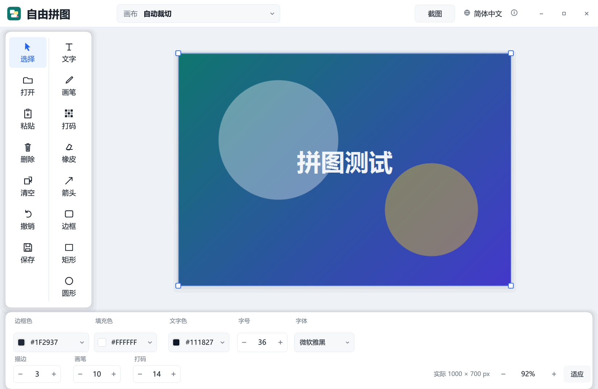

# 自由拼图 · Free Collage

[](https://github.com/heiheids/free-collage/actions/workflows/build.yml)
[](LICENSE)
[](#系统要求)

**自由拼图**是一个用 Rust 和原生 Win32 编写的轻量级拼图 / 图片标注工具。启动即进入透明自由画布，支持导入、粘贴和拖放图片，自由缩放摆放，添加文字、画笔、打码、箭头和形状，并导出为 PNG、JPEG、WebP 或 BMP。

**Free Collage** is a lightweight collage and annotation tool for Windows, written in Rust with a native Win32 UI. It opens directly onto an unlimited transparent workspace, supports drag-and-drop, paste and free transform, annotation tools, and export to PNG, JPEG, WebP or BMP.

[中文](#中文) · [English](#english) · [技术文档](#技术文档--documentation) · [构建](#构建--build) · [下载](https://github.com/heiheids/free-collage/releases/latest)



---

## 中文

### 程序简介

自由拼图面向快速拼图、截图整理和简单标注。它不依赖 Electron、Qt 或第三方 UI 运行时，界面由 tiny-skia 自绘，窗口、输入、剪贴板和截图使用 Win32 API。发布版为单个静态链接的 EXE，不需要额外 DLL。

- 程序名：自由拼图 / Free Collage
- 版本：1.0.3
- 平台：Windows 10 / 11 x64
- 技术栈：Rust 2021、Win32、tiny-skia、ab_glyph、image、webp
- 许可证：GPL-3.0-only
- 作者：黑山大叔（Heiheids）

### 功能

- **直接开始**：启动不询问文件类型或画布尺寸，直接进入透明棋盘格自由画布；默认不限大小，导出时按内容边界自动裁切。
- **原生轻量界面**：自绘无边框 Win32 窗口，高 DPI 适配；大窗口使用 1.5× UI，小窗口自动紧凑排版，最小约 940×680。
- **图片导入**：打开文件、`Ctrl+V` 粘贴、拖放文件均可；支持 PNG、JPEG、WebP、GIF（首帧）和 BMP。
- **自由拼图**：拖动摆放、四角等比缩放、滚轮缩放视图；选择工具下拖动空白处或按住空格/中键平移；双击空白或点“适应”回中。
- **磁吸对齐**：左栏“保存”下方的“磁吸”开关打开后，拖动图片靠近其他图片或固定页面边缘时会自动吸附；水平、垂直方向分别寻找最近的边并同时对齐，图片中心线也参与吸附。
- **图片裁切**：选中一张图片后，左栏“裁切”按钮才可用；点击后在图片上拖出虚线选区，确认框选择“裁切”会保留选区内像素、删除其余部分，选择“取消”则退出裁切且不修改图片。
- **图层操作**：右键图片或任意图层可上移/下移一层；上层/下层不可用时菜单自动禁用；支持撤销（最多 60 步）。
- **画布尺寸**：自动裁切；A4/B5 纵向或横向；自定义毫米尺寸与 36–1200 DPI；A4/B5 默认 300 DPI。
- **文字标注**：九种 Windows 常用字体，支持字号、文字颜色、边缘色和描边宽度；中文 IME 编辑；编辑、画布显示和导出使用同一套字体轮廓。
- **绘制工具**：画笔、打码、橡皮、箭头、边框、矩形、圆形；可设置边框色、填充色/无填充、画笔大小、打码块大小。
- **截图工具**：右上角“截图”最小化主窗口并显示截图小条；“截图窗口”支持悬停高亮目标窗口，“矩形选择”支持全屏拖拽选区；完成后自动恢复主窗口并置入截图。
- **导出**：PNG、JPEG、WebP、BMP；JPEG/WebP 可调 1–100 质量；PNG/WebP 支持透明背景，JPEG 自动填白。
- **中英双语**：启动按系统语言选择，右上角可切换；语言来自外置 `languages/*.lang`，可扩展新语言。
- **关闭确认**：有未保存改动时，关闭窗口会询问“保存 / 不保存 / 取消”；保存成功后自动退出。
- **轻量发布**：五项直接依赖全部静态链接；Release 开启 LTO、体积优化、符号剥离和静态 CRT，无额外运行时 DLL。
- **性能优化**：面板背景缓存、按需重绘、直接棋盘格写像素、图片目标尺寸采样、选择框直接合成、帧缓冲复用和批量 BGRA 转换。

### 系统要求

- Windows 10 或 Windows 11，x64
- 无需安装程序；解压发布包后运行 `自由拼图.exe`
- 首次运行在 EXE 同目录生成 `settings.cfg`，保存语言、画布、颜色、字体和导出目录

### 下载

从 [GitHub Releases](https://github.com/heiheids/free-collage/releases/latest) 下载最新的 `FreeCollage_v1.0.3_win64.zip`。发布包包含 EXE、语言文件、图标、README、GPL 许可证和第三方声明。

### 快速开始

1. 解压发布包，运行 `自由拼图.exe`。
2. 直接粘贴图片、拖入图片，或点击左侧“打开”。
3. 用“选择”工具拖动图片，拖四角手柄缩放；需要边缘对齐时打开左栏“保存”下方的“磁吸”；滚轮缩放视图，拖动空白处/空格+拖动平移；双击空白回中；右键图层可上移/下移。
4. 用左侧工具栏添加文字、画笔、打码、箭头或形状；底部属性栏调整颜色、字号、字体、描边、画笔和打码大小。选中图片后可用“裁切”拖出保留区域并确认。
5. 点击右上角“截图”可截取窗口或屏幕区域，截图会自动作为新图层加入。
6. 点击“保存”，选择格式、质量和透明背景后导出。

### 截图工具

- 点击右上角“截图”后，主窗口最小化，屏幕顶部显示截图小条。
- **截图窗口**：移动鼠标时，光标下的顶层窗口显示 4px 蓝色高亮边框；点击后截取该窗口并自动置入画布。
- **矩形选择**：进入全屏选择层，按住左键拖出矩形，松开后截取选区；`Esc` 或右键取消。
- 截图完成后主窗口恢复，新图层自动选中并适应视图。
- 小条右侧的 `×` 用于取消截图并恢复主窗口；取消不会修改画布。

### 构建

环境要求：

- Windows 10/11 x64
- Rust stable，MSVC toolchain（本项目以 Rust 1.99 验证）
- Visual Studio Build Tools，安装“使用 C++ 的桌面开发”
- Windows SDK 的 `rc.exe`（用于嵌入图标和版本资源；缺失时仍可构建，但 EXE 无图标/版本资源）

```powershell
git clone https://github.com/heiheids/free-collage.git
cd free-collage
cargo test --locked
cargo build --release --locked
```

产物：`target/release/PuzzleStudio.exe`。构建脚本会自动复制 `languages/` 和 `assets/app.ico` 到产物目录。发布包中的可执行文件重命名为 `自由拼图.exe`。

更完整的构建、打包和发布说明见 [docs/BUILD.md](docs/BUILD.md)。

### 技术文档

- [技术说明（中文）](docs/TECHNICAL.zh-CN.md)
- [Technical Notes (English)](docs/TECHNICAL.en.md)
- [构建与发布](docs/BUILD.md)
- [贡献指南](CONTRIBUTING.md)
- [第三方组件声明](THIRD_PARTY_NOTICES.txt)

### 依赖

| 依赖 | 用途 | 许可证 |
| --- | --- | --- |
| `windows-sys` | Win32 API 绑定 | MIT OR Apache-2.0 |
| `image` | PNG / JPEG / BMP / GIF 编解码 | MIT OR Apache-2.0 |
| `tiny-skia` | 抗锯齿 2D 光栅化 | BSD-3-Clause |
| `webp` + bundled `libwebp` | WebP 编解码 | MIT OR Apache-2.0；libwebp BSD-3-Clause |
| `ab_glyph` | 系统字体轮廓解析与灰度栅格化 | Apache-2.0 |

`image` 的编解码器间接依赖见 `Cargo.lock` 和 [THIRD_PARTY_NOTICES.txt](THIRD_PARTY_NOTICES.txt)。程序不随包分发字体，运行时读取系统字体。

### 已知限制

- 动画 WebP 不支持，仅静态 WebP；GIF 只取第一帧。
- 字体选择为内置九种 Windows 常用字体，不枚举所有已安装字体；缺失时回退到微软雅黑。
- 文字描边通过 16 方向灰度遮罩偏移实现，极大字号下边缘会略硬。
- 导出为扁平图片，不保存图层工程；当前版本不支持 Redo。
- 固定画布下内容可以拖出页面，导出时按页面裁切。
- 受 DRM/保护内容限制的窗口可能无法被 GDI 截取。

### 许可证

本项目以 **GNU General Public License v3.0 only（GPL-3.0-only）** 开源。你可以按照 GPLv3 的条款使用、修改和再分发；分发修改版时必须提供对应源代码并保留相同许可证。

完整文本见 [LICENSE](LICENSE)，版权声明见 [COPYRIGHT](COPYRIGHT)。本程序不提供任何担保。第三方组件保留各自许可证，见 [THIRD_PARTY_NOTICES.txt](THIRD_PARTY_NOTICES.txt)。

### 作者

黑山大叔（Heishan Dashu / Heiheids）

- GitHub：https://github.com/heiheids
- Bilibili：https://space.bilibili.com/19428259
- 项目：https://github.com/heiheids/free-collage

---

## English

### About

Free Collage is a fast, native Windows tool for collages, screenshot cleanup and light annotation. It does not use Electron, Qt or a third-party UI runtime: the interface is rasterized with tiny-skia, while window management, input, clipboard and screen capture use Win32.

- Name: Free Collage
- Version: 1.0.3
- Platform: Windows 10/11 x64
- Stack: Rust 2021, Win32, tiny-skia, ab_glyph, image, webp
- License: GPL-3.0-only
- Author: Heishan Dashu (Heiheids)

### Features

- **Start immediately** on an unlimited transparent checkerboard canvas; no startup size or file-type prompt.
- **Native lightweight UI** with a custom borderless Win32 window, DPI awareness, a 1.5× layout on large windows and a compact layout on small screens.
- **Import** via file dialog, `Ctrl+V`, or drag-and-drop; PNG, JPEG, WebP, GIF (first frame) and BMP.
- **Free arrangement**: move, scale from corners, wheel zoom, space/middle-button pan, double-click empty canvas to fit.
- **Magnetic snapping**: enable **Snap** below Save in the left toolbar; while dragging an image, nearby image/page edges and centres align automatically on both axes.
- **Image crop**: with an image selected, **Crop** becomes available; drag a dashed area over the image, then confirm to keep only that region or cancel to exit without changing the image.
- **Layers**: right-click any layer to move it up/down; undo up to 60 steps.
- **Canvas modes**: auto-crop, A4/B5 portrait or landscape, and custom millimetre sizes at 36–1200 DPI.
- **Text annotation**: nine common Windows fonts, size, colour, outline colour and width, with IME support.
- **Drawing tools**: brush, mosaic, eraser, arrow, border, rectangle and ellipse.
- **Capture**: minimize to a floating bar; capture a highlighted window or a dragged screen region, then return and paste it automatically.
- **Export**: PNG, JPEG, WebP or BMP, with quality control and transparency where supported.
- **Bilingual UI** driven by external `languages/*.lang` files.
- **Close confirmation** for unsaved changes.
- **Small release**: five direct dependencies, static CRT, no runtime DLLs.

### Build

Requirements: Windows 10/11 x64, Rust stable with the MSVC toolchain (tested with 1.99), Visual Studio Build Tools with the C++ workload, and the Windows SDK `rc.exe` for icon/version resources.

```powershell
git clone https://github.com/heiheids/free-collage.git
cd free-collage
cargo test --locked
cargo build --release --locked
```

The executable is `target/release/PuzzleStudio.exe`. `build.rs` copies the language files and application icon next to it. See [docs/BUILD.md](docs/BUILD.md) for packaging and release details.

### Documentation

- [Technical notes (English)](docs/TECHNICAL.en.md)
- [技术说明（中文）](docs/TECHNICAL.zh-CN.md)
- [Build and release](docs/BUILD.md)
- [Contributing](CONTRIBUTING.md)
- [Third-party notices](THIRD_PARTY_NOTICES.txt)

### Usage

Open or paste images, arrange them on the canvas, then add text or annotations from the left toolbar. The bottom bar controls colours, font, outline, brush and mosaic sizes. The canvas chip at the top selects auto-crop, A4/B5 portrait/landscape, or a custom page. Use the Capture button for a window or rectangular screen capture. Save exports a flattened image; layer projects are not stored.

### License

This project is free software under the **GNU General Public License v3.0 only (GPL-3.0-only)**. See [LICENSE](LICENSE) and [COPYRIGHT](COPYRIGHT). There is no warranty. Third-party components retain their own licenses; see [THIRD_PARTY_NOTICES.txt](THIRD_PARTY_NOTICES.txt).

---

## 技术文档 / Documentation

| 文档 | 内容 |
| --- | --- |
| [docs/TECHNICAL.zh-CN.md](docs/TECHNICAL.zh-CN.md) | 模块架构、渲染管线、输入、文字、截图、构建与性能 |
| [docs/TECHNICAL.en.md](docs/TECHNICAL.en.md) | Architecture, rendering, input, text, capture, build and performance |
| [docs/BUILD.md](docs/BUILD.md) | 构建、测试、打包、发布与 CI |
| [CONTRIBUTING.md](CONTRIBUTING.md) | 贡献流程与代码约定 |
| [THIRD_PARTY_NOTICES.txt](THIRD_PARTY_NOTICES.txt) | 第三方组件许可证 |

---

## License

GPL-3.0-only. Copyright (C) 2026 黑山大叔 (Heishan Dashu / heiheids).

This program is free software: you can redistribute it and/or modify it under the terms of the GNU General Public License as published by the Free Software Foundation, version 3. It is distributed in the hope that it will be useful, but **without any warranty**; without even the implied warranty of merchantability or fitness for a particular purpose. See [LICENSE](LICENSE) for the full text.
